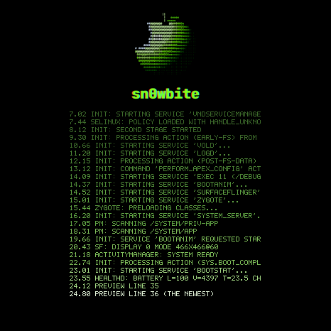

<p align="center">
  
</p>

<p align="center">
  
  
  
  
  
</p>

> *One bite is all it takes.*

**sn0wbite** is an experimental reverse-engineering project investigating
whether watchOS can boot on the **OnePlus Watch 2 (OPWWE231)**. We ship the
tooling the watch did not have — a **custom recovery with a boot menu**, a
**live verbose boot screen**, a **replacement power menu**, and a
Magisk-patched `init_boot` — and in parallel run a **virtualized Apple Watch
Series 10 (Watch7,11) under watchOS 27** inside a QEMU-SPTM fork, as a
reference platform for the port.

> **Status callout.** On 2026-10-26 we reached userspace on the virtual
> Apple Watch: a user-authored arm64 binary executed under launchd as
> `pid 3` on watchOS 27 ([recipe](./docs/watchos/userspace-shell-recipe.md)).
> On the OnePlus side, root works, the custom recovery runs on the watch,
> and a verified restoration path exists; a native watchOS boot on the
> OnePlus hardware remains unproven.

---

## Contents

- [What this project is](#what-this-project-is)
- [Status legend](#status-legend)
- [Track 1 — OnePlus Watch 2 (OPWWE231)](#track-1--oneplus-watch-2-opwwe231)
- [Track 2 — Apple Watch Series 10 under QEMU-SPTM](#track-2--apple-watch-series-10-under-qemu-sptm)
- [Repository layout](#repository-layout)
- [Documentation index](#documentation-index)
- [Roadmap](#roadmap)
- [Brand assets](#brand-assets)
- [Disclaimer](#disclaimer)

---

## What this project is

Two tracks, one goal:

1. **Make the OnePlus Watch 2 a usable research platform.** Bootloader
   unlocked, root on Android 14 A.192 via a Magisk-patched `init_boot`, a
   complete non-`userdata` backup verified by SHA-256, a documented
   restoration path demonstrated live, and a custom recovery / boot menu /
   power menu / verbose boot screen running on the watch.
2. **Build the understanding needed to actually boot watchOS on it.** The
   Apple side runs under a QEMU-SPTM fork; this is a *reference platform*
   where we can patch the kernelcache, drive it to userspace, and measure
   what the OS needs from the hardware before attempting a native port.

Nothing is pre-baked and no exploit is bundled. Builds are reproducible
from source; the firmware images in `releases/opwwe231/` are our
modifications of firmware we do not own, published for research with
SHA-256 sums.

---

## Screenshots

Running on real hardware. All frames below are our own captures of our
own code on the OnePlus Watch 2 — nothing extracted from the device.

### Custom recovery menu (v9b)

<p align="center">
  
  
  
  
</p>

Full narrative: [custom-recovery.md](./docs/opwwe231/custom-recovery.md).

### Live verbose boot screen

<p align="center">
  
</p>

Rewritten frames inside the stock animation zip. Full narrative:
[boot-screen.md](./docs/opwwe231/boot-screen.md).

### Payload runner (recovery flight recorder)

<p align="center">
  
</p>

The recovery can execute a user-supplied payload inside its own address
space and surface the output; this is the frame that will later carry a
loader attempting a watchOS kernelcache.

---

## Status legend

| Symbol | Meaning |
| --- | --- |
| ✅ | Shipping — working and documented |
| 🟡 | Partial — works but has caveats called out in docs |
| 🧪 | Experimental — latest research; may regress |
| 🔜 | Planned — not implemented yet |

---

## Track 1 — OnePlus Watch 2 (OPWWE231)

Research snapshot: **20 October 2026**, updated **24 October 2026**.

| Area | State | Notes |
| --- | --- | --- |
| Target identity | ✅ | **OnePlus Watch 2 / OPWWE231**, Qualcomm W5 Gen 1 (`monaco`). Installed firmware **A.192.260910** (Android 14), ARM64-capable kernel, **32-bit-only (`armeabi-v7a`) Android userspace** |
| Bootloader + root | ✅ | Bootloader **unlocked**, **root via Magisk** confirmed working, raw storage reads for all partitions. [How](./docs/opwwe231/root-and-boot-customization.md) |
| Storage inventory | ✅ | **63 named partitions**; ADB mappings match fastboot sizes and types |
| Complete backup | ✅ | **62 of 63 non-`userdata` partitions** acquired and SHA-256 verified; `userdata` excluded by choice |
| Restoration | ✅ | Documented, checksummed restore path **demonstrated live** during a real recovery |
| Custom recovery | ✅ | Menu with Wear OS, dual boot, stock recovery, fastboot, info, power off; watchdog, flight recorder, payload runner. **Running on the watch — no second OS boots yet.** [Docs](./docs/opwwe231/custom-recovery.md) |
| Boot screen | ✅ | Live kernel log scrolling under a small logo during Wear OS boot — frames rewritten inside the stock animation zip. [Docs](./docs/opwwe231/boot-screen.md) |
| Power menu | ✅ | Hold POWER opens our menu (Restart, Recovery, Fastboot, Power off) as a priv-app with no root; also pins the custom recovery. [Docs](./docs/opwwe231/hardware-buttons.md) |
| Releases | ✅ | Magisk-patched `init_boot`, recovery image, boot screen and power menu modules, with SHA-256 sums. [releases/opwwe231](./releases/opwwe231/README.md) |
| Native watchOS boot | 🔜 | Blocked on Apple-side understanding (Track 2) |

### Quick start — flash a release

```bash
# One-time: get your own full partition backup first (see docs/opwwe231/).
# Flashing is destructive. Verify SHA-256 against releases/opwwe231/SHA256SUMS.
cd tools/opwwe231/recovery-menu
WATCH_ADB_SERIAL=<serial> ./flash_recovery.sh ../../releases/opwwe231/recovery_sn0wmenu_v9b.img
```

Each tool under `tools/opwwe231/` has its own `BUILD.md` with the full
build-from-source recipe.

---

## Track 2 — Apple Watch Series 10 under QEMU-SPTM

Research snapshot: **26 October 2026**.

Virtualized `Watch7,11` (T8310, watchOS 27). Everything below reproduces
from the public IPSW `restore_payload` + a built QEMU-SPTM fork; no
physical device required.

| Stage | State | Notes |
| --- | --- | --- |
| Kernelcache boot (base chain) | ✅ | 9-patch APFS/launchctl baseline (`bootkc.before-exp10`) reaches IOKit serial driver match. [Docs](./docs/watchos/qemu-sptm-watch7-11-boot.md) |
| Patch harness | ✅ | `patchkit` applies versioned YAML manifests; 38 numbered experiments [exp10–38](./docs/watchos/) |
| AMFI trust-cache override | ✅ | Breakthrough patch at `_vnode_check_signature` lets IOKit match proceed. [exp16 writeup](./docs/watchos/exp16-amfi-trust-cache-breakthrough.md) |
| Trust-cache format reversed | ✅ | v1 header + 22 B entries (20 B cdhash SHA-256, 2 B flags, sorted). [Rebuilder](./tools/watchos/qemu-sptm/userspace/sn0shell/build-tc.py) |
| Userspace exec | ✅ | User-authored arm64 binary (`sn0shell`) runs as `pid 3` under launchd on watchOS 27 — [recipe](./docs/watchos/userspace-shell-recipe.md) |
| Interactive REPL | ✅ | sn0shell 11-command REPL: `help`, `version`, `cat`, `ls`, `sysctl`, `mach`, `cpuload`, `vmstat`, `devices`, `write`, `echo` |
| arm64e / PAC-enabled userspace | 🧪 | `ARCH=arm64e ./build.sh` compiles cleanly; needs on-VM validation |
| Native boot on OnePlus hardware | 🔜 | Blocked on T8006 adaptation (sn0w CPU layer in progress). [port plan](./docs/watchos/boot-chain-port-plan.md) |

### Quick start — boot the virtual Apple Watch into a user shell

Prereqs: macOS with Xcode (watchOS SDK), a QEMU-SPTM build and the Watch
Series 10 restore IPSW staged under `.scratchpad-local/`. See
[`docs/watchos/full-boot-walkthrough.md`](./docs/watchos/full-boot-walkthrough.md)
for the one-time setup.

```bash
# Three-command boot
tools/watchos/qemu-sptm/userspace/sn0shell/build.sh      # compile + sign sn0shell
tools/watchos/qemu-sptm/userspace/sn0shell/deploy.sh     # install into ramdisk + refresh TC (sudo)
tools/watchos/qemu-sptm/boot.sh                          # QEMU — serial prints [SN0WBITE] markers
```

```
sn0shell# help
sn0shell# version
sn0shell 0.2 (sn0wbite / Watch7,11 / watchOS 27)
kern.version: Darwin Kernel Version ...
sn0shell# mach
max_cpus:        2
avail_cpus:      2
memory_size:     8589934592 bytes
...
sn0shell# exit
```

---

## Repository layout

```text
sn0wbite/
├── README.md                   this file
├── CLAUDE.md                   agent guidance for Claude Code sessions
│
├── assets/
│   └── branding/               logo, banner, avatars, icons, social preview
│
├── docs/
│   ├── README.md               research index (findings → evidence)
│   ├── evidence-policy.md      publication/redaction rules
│   ├── images/                 screenshots used by docs
│   ├── opwwe231/               Track 1 — OnePlus Watch 2 narrative docs
│   │                             device, storage, OTA, recovery, root,
│   │                             custom-boot, boot screen, hardware buttons
│   └── watchos/                Track 2 — Apple Watch Series 10 / watchOS 27
│                                 boot-chain analysis, 38 numbered experiments,
│                                 gdbstub findings, full-boot walkthrough,
│                                 userspace shell recipe, logs/
│
├── research/                   evidence collections (dated, per device)
│   └── opwwe231/
│       ├── 2026-10-20-a192/
│       ├── 2026-10-21-root-magisk/
│       ├── 2026-10-24-custom-boot/
│       └── 2026-10-24-watchos-boot/
│
├── releases/
│   └── opwwe231/               flashable images + SHA-256 sums
│
├── tools/
│   ├── README.md               tool index
│   ├── ota/                    OPPO/HeyTap OTA client (reconstructed from OHealth)
│   ├── opwwe231/               Track 1 — OnePlus-specific tools
│   │   ├── magisk/               Magisk patcher helper (`init_boot`)
│   │   ├── powermenu/            replacement power menu + priv-app module
│   │   └── recovery-menu/        custom recovery, boot menu, dual slot, bootanim
│   │
│   └── watchos/                Track 2 — Apple Watch RE/emulation tools
│       ├── bootargs/             boot_args struct + builder (loader side)
│       ├── emu/                  Unicorn early-boot harness (phase 1)
│       ├── port/                 PAC/Apple-register census + patcher
│       ├── probe/                `cpuprobe` — reads CPU ID regs from EL0
│       ├── qemu/                 QEMU t8006 adaptation + sn0w CPU shim
│       └── qemu-sptm/            QEMU-SPTM userspace bringup
│           ├── boot.sh             wrapper for the darwin-vm run.sh
│           ├── patchkit/           YAML-driven kernelcache patch applier
│           ├── gdbstub/            LLDB callback helpers + BRK findings
│           ├── scripts/            per-experiment asm builders (exp15..exp29)
│           ├── ida_work/           Hex-Rays decompile snapshots
│           └── userspace/
│               └── sn0shell/       the custom user binary + build/deploy chain
│
├── backups/                    private local acquisitions (gitignored)
└── .scratchpad-local/          large binary artefacts (gitignored):
                                  firmware, kernelcache experiments, DMGs,
                                  QEMU-SPTM build. ~24 GB on this machine.
```

---

## Documentation index

Track-indexed quick links. For the full research index with evidence
pointers, see [`docs/README.md`](./docs/README.md).

### Track 1 — OnePlus Watch 2

| Topic | Read |
| --- | --- |
| Device identity, ADB, root, storage | [device-and-storage.md](./docs/opwwe231/device-and-storage.md) |
| OTA history, paired-phone analysis | [ota-and-ohealth.md](./docs/opwwe231/ota-and-ohealth.md) |
| Stock recovery, fastboot, EDL | [recovery.md](./docs/opwwe231/recovery.md) |
| Root + Magisk + boot customization | [root-and-boot-customization.md](./docs/opwwe231/root-and-boot-customization.md) |
| Custom recovery + boot menu + dual slot | [custom-recovery.md](./docs/opwwe231/custom-recovery.md) |
| Live verbose boot screen | [boot-screen.md](./docs/opwwe231/boot-screen.md) |
| Hardware buttons + replacement power menu | [hardware-buttons.md](./docs/opwwe231/hardware-buttons.md) |

### Track 2 — Apple Watch under QEMU-SPTM

| Topic | Read |
| --- | --- |
| Full boot walkthrough (prereqs → shell) | [full-boot-walkthrough.md](./docs/watchos/full-boot-walkthrough.md) |
| Userspace shell recipe (sn0shell) | [userspace-shell-recipe.md](./docs/watchos/userspace-shell-recipe.md) |
| QEMU build + boot | [qemu-build-and-boot.md](./docs/watchos/qemu-build-and-boot.md) |
| QEMU-SPTM Watch7,11 boot specifics | [qemu-sptm-watch7-11-boot.md](./docs/watchos/qemu-sptm-watch7-11-boot.md) |
| Boot chain reconstruction (x0 contract) | [boot-chain-reconstruction.md](./docs/watchos/boot-chain-reconstruction.md) |
| Port plan toward native UI | [boot-chain-port-plan.md](./docs/watchos/boot-chain-port-plan.md) |
| AMFI trust-cache breakthrough (exp16) | [exp16-amfi-trust-cache-breakthrough.md](./docs/watchos/exp16-amfi-trust-cache-breakthrough.md) |
| Experiment history (exp10..exp29) | [exp10-14-dead-ends.md](./docs/watchos/exp10-14-dead-ends.md) → [exp27-28-os-reason-logger.md](./docs/watchos/exp27-28-os-reason-logger.md) |
| LLDB gdbstub + BRK trap technique | [gdbstub-brk-findings.md](./docs/watchos/gdbstub-brk-findings.md) |
| Platform device map (T8006) | [platform-device-map.md](./docs/watchos/platform-device-map.md) |
| watchOS boot + ISA analysis | [watchos-boot-and-isa-analysis.md](./docs/watchos/watchos-boot-and-isa-analysis.md) |
| Bring-up status + measurements | [bring-up-status.md](./docs/watchos/bring-up-status.md) |

### Policy

- [Evidence publication policy](./docs/evidence-policy.md) — what we retain,
  redact or release.

---

## Roadmap

- [x] Identify the attached watch and record its installed firmware and security state.
- [x] Inventory partition names and bootloader-reported sizes (63 partitions).
- [x] Identify the supplied watchOS reference package and record its archive hash.
- [x] Obtain privileged storage reads while preserving the current device state.
- [x] Acquire and verify complete storage images, including companion-firmware coverage.
- [x] Establish a documented restoration path for this exact device.
- [x] Build a custom recovery with a boot menu, watchdog, flight recorder and dual boot slot.
- [x] Show live boot diagnostics on screen during Wear OS boot.
- [x] Replace the stock power menu with one offering Recovery and Fastboot.
- [x] Publish the modified images, tools and findings.
- [x] **Boot the watchOS 27 kernelcache under QEMU-SPTM to IOKit** *(exp16)*
- [x] **Reach userspace exec on the virtual Apple Watch** *(sn0shell as pid 3, 2026-10-26)*
- [x] **Deliver an interactive REPL in userspace** *(11-command sn0shell)*
- [ ] Validate arm64e / PAC-enabled userspace on the VM.
- [ ] IOKit userspace probing of serial / PMU / USB endpoints.
- [ ] Resolve T8006 interrupt-controller routing (AIC) — the gate to a
      console-producing boot on the native-target QEMU path.
- [ ] Establish controlled payload execution and diagnostic output on the
      physical OnePlus Watch 2.
- [ ] Demonstrate repeatable watchOS kernel execution on OPWWE231 hardware.

---

## Brand assets

The [brand directory](./assets/branding/README.md) contains the supplied
logos, banner and social preview in their original formats.

---

## Disclaimer

This project is for educational and research purposes. It has **no
affiliation** with Apple Inc. or OnePlus. watchOS is a trademark of Apple
Inc. Apple Watch, Watch7,11 and watchOS 27 are referenced only as the
reverse-engineering target under emulation — no Apple firmware is
redistributed from this repository.

Modifying or flashing firmware can erase data or brick the device. The
images in [releases/opwwe231](./releases/opwwe231/README.md) are our
modifications of firmware we do not own; they are published as-is for
research. Use at your own risk.
