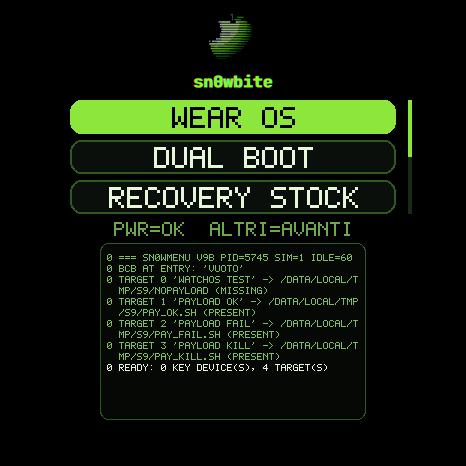
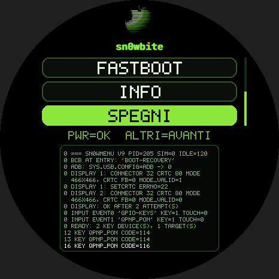
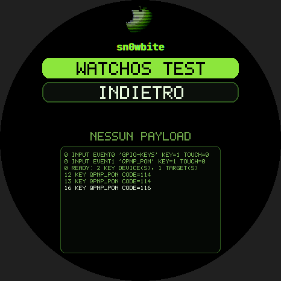
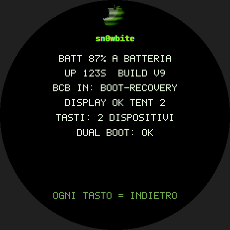
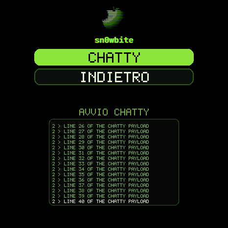

# Custom recovery and boot menu for OPWWE231

Research and build dates: **22 to 24 October 2026**. Target: **OPWWE231 A.192**, bootloader unlocked.
Images: [releases/opwwe231](../../releases/opwwe231/README.md). Sources and scripts:
[tools/opwwe231/recovery-menu](../../tools/opwwe231/recovery-menu/src/BUILD.md). Evidence:
[24 October collection](../../research/opwwe231/2026-10-24-custom-boot/README.md).

The watch is not A/B, has no second kernel slot and cannot `kexec` (EL1 only). A boot menu therefore has to live in the
`recovery` partition, which the bootloader starts on request. We replaced the recovery's UI process with our own menu and left
the stock recovery binary in the same image, so the menu can hand over to it.

  
 

## What it does

- Draws a menu on the round 466x466 panel: logo, scrolling list, hint line and a verbose window that prints the last 15 log lines.
- Reads the two hardware buttons: POWER (key 116) selects, the other button (key 114) moves down. Recovery has no touch device.
- Entries: **WEAR OS** (normal reboot), **DUAL BOOT** (payload list), **RECOVERY STOCK** (hands over to the stock recovery),
  **FASTBOOT** (reboot to the bootloader), **INFO** (battery, uptime, BCB at entry, display attempts, key devices) and **SPEGNI**.
- Runs a dual boot framework: payloads are listed in a file inside the image, run as a child with the BCB set and an in-flight
  marker in `misc`, and their output appears in the verbose window. If the watch resets during an attempt, the menu comes back
  once and reports it. No second operating system ships with it.
- Leaves for Wear OS after 120 s without a key press, and a second init service reboots the watch if the menu hangs.
- Keeps a flight recorder in `misc` that is read back from Android, because `adb shell` does not work in this recovery.

## Verification status

| Item | Status |
| --- | --- |
| Image accepted by the bootloader, menu starts, init service armed | Verified on the watch |
| Display, both buttons, WEAR OS exit, FASTBOOT exit | Verified on the watch ([flight recorder](../../research/opwwe231/2026-10-24-custom-boot/recovery-flight-recorder-hardware-runs.txt)) |
| DUAL BOOT list loaded from the image | Verified on the watch with V9B (`1 target(s)`) |
| Payload run, in-flight marker, idle exit, watchdog cases, payload output, battery rule | Simulated on the watch with `--sim` ([regression](../../research/opwwe231/2026-10-24-custom-boot/recovery-simulation-regression.txt)) |
| Entering it from the running watch (power menu, then Recovery) and surviving Android boots | Verified on the watch: the partition hash is unchanged after a boot |
| INFO page, SPEGNI (`shutdown,`), RECOVERY STOCK, hard reset inside the menu, watchdog firing for real | Not recorded on hardware yet |

## How it works

**Image.** The stock `recovery` is a boot image v4 with no kernel: it runs on the kernel of `boot` with its own ramdisk. We
change two files in that ramdisk (`init.rc` starts `/system/bin/sn0wmenu` instead of `/system/bin/recovery`, as a oneshot service;
`init.recovery.qcom.rc` gets the watchdog service) and add two files (`sn0wmenu`, `system/etc/sn0w-targets.conf`). 91 cosmetic
files (installing-animation frames beyond the third, `erofs` tools) are dropped to fit. `pack_menu9.py` builds the image and
`verify_image.py` diffs it against the stock one: the stock `recovery` binary and the SELinux policy stay byte-identical.

**Display.** Plain legacy DRM calls, like AOSP's minui: connector 32, CRTC 80, mode 466x466@60, two dumb buffers, XBGR8888 through
`ADDFB2`, `SETCRTC` then `PAGE_FLIP`. The first `SETCRTC` fails with `EINVAL` because the bootloader splash is still active
(CRTC `mode_valid=1`, `fb=0`). Closing the DRM device runs the driver's `lastclose`, which disables the pipeline; reopening
immediately works. The menu does this in up to three attempts and reboots to Wear OS if the display never comes up.

**Leaving.** Only `sys.powerctl` works. The `recovery` SELinux domain has no `sys_boot` capability and cannot write
`/proc/sysrq-trigger`, so a raw `reboot()` is denied. The menu clears the display (`SETCRTC` off, close) before every exit.

**BCB, the fail-open rule.** When recovery is entered with `adb reboot recovery`, `misc` already holds `boot-recovery` at
offset 0, and the bootloader reads it again at every boot until someone zeroes it. The menu zeroes `misc[0..2048]` as its first
action and before every exit, so a crash or a hard reset boots Wear OS. It sets the BCB only while a payload runs.

**Watchdog.** `sn0wmenu --deadman` runs as a second init service and watches a heartbeat file written by the menu. It reboots
(clearing the BCB first) when the heartbeat stops for 20 s, when no heartbeat appears within 60 s, past the idle deadline
(120 s plus 45 s), over a 3000 s cap, or when the battery is at 15% or lower and not charging. It needs two bad readings in a
row and stands down while the stock recovery runs.

**Dual boot.** `sn0w-targets.conf` lists `LABEL|/path/to/payload`. A missing payload shows dimmed and says NESSUN PAYLOAD. A
selected payload runs as a child while the heartbeat and the screen stay alive, with a 10 minute timeout; key presses made
meanwhile are dropped; stdout and stderr go to the window and the first 30 lines also to the flight recorder.

**Flight recorder.** 24,000 bytes in `misc` at `0x9000`, an in-flight marker at `0x8000`. Read it from Android with
`read_flightlog.sh`.

## Rules we learned the hard way

| Incident or observation | Cause | Rule |
| --- | --- | --- |
| An image of 12.4 MB made the bootloader refuse recovery and stop in fastboot | The partition keeps its AVB metadata in the bytes after the image (footer `original_image_size` = 12,083,200) | Keep the image below 12,083,200 bytes. The packer and flasher enforce a 64 KiB margin |
| First menu froze on the boot logo until the battery ran out | No reboot path (no `sys_boot`), no timeouts, nothing drawn | Leave through `sys.powerctl`, always have timers and a watchdog |
| Probes looped back into recovery after every reboot | The BCB `boot-recovery` stays until zeroed | Zero it first and before every exit |
| `SETCRTC` always `EINVAL` | Bootloader splash still owns the pipeline | Close and reopen the DRM device |
| The targets file was missing on the watch | The kernel's initramfs unpacker does not create parent directories, so a cpio entry listed before its directory is dropped | Every added entry must follow its parent directory. The packer and verifier check it |
| A custom recovery disappears after one Android boot | `vendor_flash_recovery` runs `/vendor/bin/install-recovery.sh`, which rebuilds the stock recovery from `boot` when the partition's SHA-1 differs | The `sn0wbite_powermenu` module overrides that script with a no-op. Without the module, flash right before entering; from fastboot, `fastboot reboot recovery` keeps the image |
| `adb shell` and `adb pull` of `/tmp` fail in recovery | Stock policy | Use the flight recorder; `adb reboot [bootloader]` still works |
| A bogus "attempt failed" notice on the first V9 start | Old builds used the same `misc` offset and magic for a binary struct | The marker now needs a printable label |

## Build, verify, flash, restore

```sh
cd tools/opwwe231/recovery-menu/src
# build sn0wmenu9 with the Android NDK (see BUILD.md), then:
python3 -I pack_menu9.py <stock recovery dump> sn0wmenu9.stripped sn0w-targets.conf recovery_menu.img
python3 -I verify_image.py <stock recovery dump> recovery_menu.img sn0wmenu9.stripped sn0w-targets.conf
cd .. && export WATCH_ADB_SERIAL=<serial> STOCK_RECOVERY_DUMP=<your dd dump of the recovery partition>
./flash_recovery.sh --check recovery_menu.img     # writes nothing
./flash_recovery.sh recovery_menu.img             # size guard, readback, AVB tail check
./enter_menu.sh                                   # adb reboot recovery
./read_flightlog.sh                               # after Android is back
```

Restore the stock recovery with `restore_stock_recovery.sh` (set `STOCK_RECOVERY_SHA256` too), from Android or from fastboot.
Take your own full `dd` dump of the recovery partition first: the scripts check the partition tail against it.
The menu logic can be tested without flashing: `src/test_sim9.sh` runs it in `--sim` mode on the watch.

## Limits and open work

- With the `sn0wbite_powermenu` module the custom recovery is permanent: the module turns the stock rebuild into a no-op. Without it, Android restores the stock recovery at the next boot. Restoring stock means removing the module and flashing your own dump with `restore_stock_recovery.sh`.
- There is no payload yet. Candidates are an image in a spare partition loaded from Android.
- The stock recovery entry starts it with no arguments (the "No command" screen); the effect of its `--bootmenu` option is
  not analysed.
- The menu on the running watch that opens this recovery is described in [Hardware buttons](../device/hardware-buttons.md).
